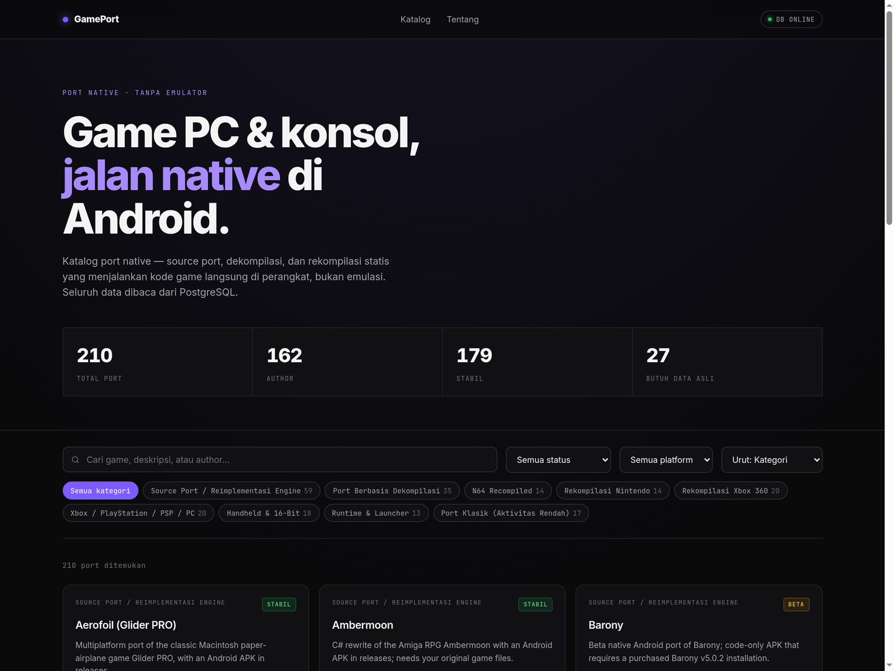

# GamePort

Katalog port native Android dari game PC & konsol — source port, dekompilasi,
dan rekompilasi statis yang menjalankan kode game langsung di perangkat,
bukan emulasi.

**Backend Go · PostgreSQL · frontend vanilla HTML/CSS/JS · Docker Compose**



---

## Isi

- [Arsitektur](#arsitektur)
- [Menjalankan dengan Docker](#menjalankan-dengan-docker)
- [Menjalankan tanpa Docker](#menjalankan-tanpa-docker)
- [Struktur project](#struktur-project)
- [API](#api)
- [Database](#database)
- [Memuat data dari sumber](#memuat-data-dari-sumber)
- [Pengembangan](#pengembangan)

---

## Arsitektur

```
┌──────────────┐     HTTP/JSON      ┌──────────────┐     pgx      ┌──────────────┐
│   Browser    │ ─────────────────► │  Go backend  │ ───────────► │  PostgreSQL  │
│  (vanilla)   │ ◄───────────────── │  :8181       │ ◄─────────── │  gamedb      │
└──────────────┘                    └──────────────┘              └──────────────┘
```

Frontend **tidak** menyimpan data apa pun. Semua angka, kartu, dan filter
berasal dari API, yang membaca view PostgreSQL. Tidak ada kredensial database
di sisi klien.

---

## Menjalankan dengan Docker

```bash
cp .env.example .env
# edit .env, isi GAMEDB_PASSWORD dengan password yang kuat

docker compose up -d --build
```

Buka <http://127.0.0.1:8181>.

Saat volume `pgdata` masih kosong, PostgreSQL otomatis menjalankan
`db/seed.sql` — skema dan data contoh langsung siap.

Perintah yang sering dipakai:

```bash
docker compose logs -f backend     # log backend
docker compose ps                  # status layanan
docker compose down                # hentikan, data tetap
docker compose down -v             # hentikan + hapus volume (mulai dari nol)
```

### Memuat 210 port dari sumber asli

Seed hanya berisi 4 contoh. Untuk memuat katalog lengkap:

```bash
docker compose --profile tools run --rm etl
```

ETL mengambil daftar dari `awesome-android-native-ports`, mem-parse tabel
markdown, lalu meng-`UPSERT` ke database. Aman dijalankan berulang.

---

## Menjalankan tanpa Docker

Butuh Go 1.23+ dan PostgreSQL yang sudah jalan.

```bash
createdb gamedb
psql -d gamedb -f db/seed.sql

export GAMEDB_HOST=127.0.0.1 GAMEDB_PORT=5432 GAMEDB_NAME=gamedb
export GAMEDB_USER=postgres GAMEDB_PASSWORD=rahasia

go run ./cmd/server
```

Untuk ETL tanpa Docker:

```bash
pip install 'psycopg[binary]'
GAMEDB_HOST=127.0.0.1 GAMEDB_USER=postgres GAMEDB_PASSWORD=rahasia \
  python3 etl/etl.py
```

---

## Struktur project

```
.
├── cmd/server/main.go          entrypoint, graceful shutdown
├── internal/
│   ├── config/config.go        konfigurasi dari environment
│   ├── db/
│   │   ├── db.go               pool pgx + health
│   │   ├── models.go           tipe JSON
│   │   └── queries.go          SQL, filter, paginasi
│   └── api/server.go           router, handler, CORS, static
├── static/                     frontend vanilla
│   ├── index.html
│   ├── style.css
│   └── app.js
├── db/seed.sql                 skema + data awal (idempoten)
├── etl/etl.py                  crawler + loader 210 port
├── Dockerfile                  build multi-stage Go
├── Dockerfile.etl              image khusus ETL
└── docker-compose.yml
```

---

## API

Semua respons JSON. Tidak ada autentikasi (katalog publik, read-only).

| Endpoint | Keterangan |
|---|---|
| `GET /api/health` | status koneksi DB + statistik pool |
| `GET /api/statistik` | angka agregat untuk dashboard |
| `GET /api/kategori` | kategori + jumlah port |
| `GET /api/status` | status kematangan + jumlah |
| `GET /api/platform` | platform + jumlah |
| `GET /api/engine` | engine + jumlah |
| `GET /api/ports` | daftar port (filter, sort, paginasi) |
| `GET /api/ports/{slug}` | detail satu port + 6 terkait |

### Parameter `/api/ports`

| Param | Nilai | Default |
|---|---|---|
| `q` | pencarian teks (game/deskripsi/author) | — |
| `kategori` | slug, boleh berkoma | — |
| `status` | `stable`, `beta`, `experimental`, `alpha` | — |
| `platform` | `android`, `windows`, `linux`, … | — |
| `own` | `0` / `1` (butuh data asli) | — |
| `sort` | `kategori`, `nama`, `nama-desc`, `status` | `kategori` |
| `limit` | 1–200 | 24 |
| `offset` | ≥ 0 | 0 |

Contoh:

```bash
curl 'http://127.0.0.1:8181/api/ports?q=zelda'
curl 'http://127.0.0.1:8181/api/ports?status=alpha&platform=android'
curl 'http://127.0.0.1:8181/api/ports/half-life-xash3d-fwgs'
```

---

## Database

Tabel referensi (`categories`, `statuses`, `platforms`, `engines`,
`features`) dan tabel konten (`ports`) dengan relasi banyak-ke-banyak
(`port_platforms`, `port_engines`, `port_features`).

Dua view:
- `v_port_detail` — meratakan join menjadi array; dipakai API
- `v_statistik` — agregat untuk dashboard

Atribut multi-nilai disimpan di tabel join, bukan string berkoma, supaya
filter tidak salah cocok.

---

## Memuat data dari sumber

Sumber: [awesome-android-native-ports](https://github.com/abduznik/awesome-android-native-ports)
(daftar terkurasi di git, berbentuk tabel markdown — stabil dan bisa di-diff,
jauh lebih andal daripada scraping HTML).

```bash
python3 etl/etl.py --dry-run    # parse saja, tidak menyimpan
python3 etl/etl.py              # crawl + muat
python3 etl/etl.py --file X.md  # pakai file lokal
```

ETL menurunkan atribut dari deskripsi dengan aturan berpola: platform,
engine, status kematangan, kebutuhan data asli, dan fitur.

---

## Pengembangan

```bash
go vet ./...          # analisis statis
go build ./...        # kompilasi
go run ./cmd/server   # jalankan lokal
```

Konfigurasi lewat environment. Lihat `.env.example` untuk daftar lengkap.

Untuk menambah endpoint: tambah method di `internal/db/queries.go`, daftarkan
rute di `internal/api/server.go`.

---

## Lisensi

Kode: MIT.
Data: milik masing-masing proyek port; lihat repo sumber.